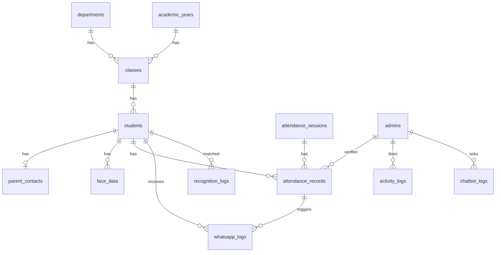

# 1. Analisis, Teknologi, Arsitektur

## Keputusan teknologi (sesuai pilihanmu: Next.js + Supabase)
| Lapisan | Dipilih | Alasan | Alternatif yang ditolak |
|---|---|---|---|
| Frontend | **Next.js 14 (React) + Tailwind, PWA** | Satu kode untuk HP/tablet/PC, bisa di-install dari browser (tanpa Mac/App Store), deploy Vercel gratis | Flutter (kamera web + face lib lebih rumit), PHP native (PWA & komponen interaktif lebih berat) |
| Backend | **Next.js Route Handlers (Node)** | Satu proyek, rahasia (service key, kunci enkripsi) tetap di server | Laravel/FastAPI = 2 deployment terpisah |
| Database | **Supabase PostgreSQL** | Relasional, constraint UNIQUE untuk anti-ganda, backup, gratis untuk skala sekolah | MySQL (hosting gratis terbatas) |
| Face Recognition | **face-api.js (@vladmandic/face-api)**: TinyFaceDetector + Landmark68 + FaceRecognitionNet (128-d) | Jalan di browser (HP biasa), tanpa GPU/server AI, bundle & model **lokal** (tanpa CDN), akurasi LFW ±99% | InsightFace/DeepFace (butuh server Python/GPU, biaya & latensi), MediaPipe (detektor saja, tanpa embedding identitas), FaceNet (perlu konversi model) |
| Liveness | Deteksi **kedip** (Eye Aspect Ratio dari 68 landmark) | Ringan, efektif menolak foto statis/layar foto | Depth/IR (butuh hardware khusus) |
| Suara | Web Speech API `id-ID` | Bawaan browser, gratis | Flutter TTS (hanya jika memakai Flutter) |
| WhatsApp | Meta **WhatsApp Cloud API** resmi | Tidak berisiko blokir nomor | Library tidak resmi (ditolak sesuai syarat) |
| AI | Claude API (opsional) + chatbot aturan | Tetap jalan tanpa API key | – |

## Arsitektur
```
[Kiosk HP/Tablet/PC /presensi]                [Admin /admin]
  kamera → face-api.js (browser)                 Dashboard, Siswa, Laporan, ...
  descriptor 128-d + liveness ─┐                        │ cookie sesi (JWT httpOnly)
                               ▼                        ▼
                  Next.js Route Handlers (server, Vercel/Node)
     /api/presensi/recognize  → cocokkan embedding (didekripsi di server) → simpan → WA → suara dari respons
     /api/*                   → validasi, audit log, service-role ke Supabase
                               ▼
                    Supabase PostgreSQL (RLS aktif tanpa policy: anon key tidak bisa baca apa pun)
```
Prinsip: **embedding tidak pernah dikirim ke browser**; browser hanya mengirim descriptor probe. Waktu presensi = waktu server (WIB).

## Cara kerja Face Recognition
1. *Pendaftaran*: admin ambil 3–8 sampel (sudut berbeda) → tiap sampel menjadi vektor 128 angka → dienkripsi AES-256-GCM → tabel `face_data`.
2. *Presensi*: kamera → TinyFaceDetector (deteksi) → Landmark68 → hitung EAR → tunggu **kedip** (liveness) → hitung descriptor → POST ke server.
3. *Pencocokan*: server menghitung jarak Euclidean ke semua sampel, ambil jarak terbaik per siswa. Diterima jika `jarak ≤ threshold` (default 0,50) **dan** selisih dengan siswa terdekat kedua `≥ margin` (0,04). Ini yang membedakan *recognition* dari sekadar *detection*.
4. Cek jam buka/tutup & sesi → tentukan hadir/terlambat → INSERT (UNIQUE mencegah ganda) → kirim WA (jika aktif) → balas data siswa + kalimat suara.

## Suara otomatis
Respons server berisi kalimat dari template (`Pengaturan → tts_template`). Browser memutar lewat `speechSynthesis` (id-ID). Tombol "Aktifkan Kamera & Mulai" sekaligus *membuka kunci* suara (aturan autoplay, terutama iOS). Pencegah berulang: jeda 5 detik antar pemindaian + wajah yang sama tidak diucapkan lagi dalam 30 detik; server menolak catatan ganda.

## ERD

Tabel lain: `attendance_settings` (jadwal rutin), `whatsapp_templates`, `notifications`, `app_settings`. Kunci penting: `students.nis UNIQUE`, `attendance_sessions UNIQUE(activity, session_date)`, `attendance_records UNIQUE(session_id, student_id)`.

## Struktur folder
```
app/            halaman (login, presensi kiosk, admin/*) & app/api/* (backend)
components/     Shell (sidebar/bottom-nav), UI, Charts, FaceRegister, PwaBoot
lib/            db, auth, crypto, face (matching), wa, chatbot, report, stats, time, settings, pure
public/         manifest, sw.js, icons, models/ (face-api), vendor/face-api.js
sql/schema.sql  skema + data awal      scripts/  seed-admin, backup, gen-keys
tests/          uji unit               docs/     dokumentasi
```

## Perkiraan biaya
| Layanan | Biaya |
|---|---|
| Supabase Free (500 MB DB) | Rp 0 (cukup untuk ±ribuan siswa × ratusan hari). Pro ≈ US$25/bln bila perlu backup harian/tanpa *pause* |
| Vercel Hobby | Rp 0 (cocok untuk penelitian non-komersial); Pro ≈ US$20/bln |
| Domain (opsional) | ±Rp 150–250 rb/tahun |
| WhatsApp Cloud API | Pendaftaran gratis; **pesan template berbayar per pesan** sesuai tarif Meta (cek tarif Indonesia terbaru) |
| Claude API (opsional) | Bayar per token; chatbot ringan ≈ beberapa ribu rupiah/bulan |
> Angka tarif dapat berubah — verifikasi di situs resmi masing-masing sebelum produksi.

## Langkah pengembangan
1. Setup Supabase + `schema.sql` → 2. isi `.env.local`, seed admin → 3. buat jurusan/kelas/siswa → 4. daftarkan wajah → 5. uji presensi (PC → Android → iPhone via HTTPS) → 6. kalibrasi threshold dengan data uji (lihat `03-PENGUJIAN.md`) → 7. deploy Vercel → 8. aktifkan WA/AI → 9. pengumpulan data penelitian (laporan Excel).
